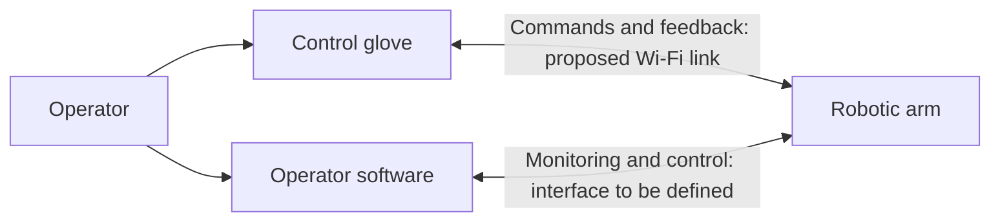

# Remote Robotic Arm — Team 26

Computer Engineering and Electrical Engineering capstone project developing a remotely operated robotic arm for manipulating objects during sensitive procedures.

The planned system combines a wearable control glove, a robotic arm, and operator software. GitHub holds source code, tasks, reviews, and test evidence. Editable reports stay in Google Drive and are linked from the [documentation index](docs/README.md).

## System overview



This is a conceptual architecture. Network topology, message formats, command arbitration, and safety behaviour need design review. The supplied planning summary describes a Go backend with htmx and Go Templates; these choices remain proposed until checked against the source design documents.

## Team dashboard

| Area | Repository status | Entry point |
| --- | --- | --- |
| Control glove | Folder prepared; implementation not added | [Firmware](firmware/control-glove/README.md), [hardware](hardware/control-glove/README.md) |
| Robotic arm | Folder prepared; implementation not added | [Firmware](firmware/robotic-arm/README.md), [hardware](hardware/robotic-arm/README.md) |
| Operator software | Folder prepared; implementation not added | [Software](software/operator-control/README.md) |
| Verification | Categories prepared; no tests implemented | [Test guide](tests/README.md) |
| Project planning | Board setup and task import awaiting source verification | [Planning guide](docs/planning.md) |

These describe repository contents, not the team's progress outside GitHub.

- [Editable document index](docs/README.md)
- [Requirements and open questions](docs/requirements.md)
- [Design decisions](docs/decisions/README.md)
- [GitHub Issues](https://github.com/TuxHood/BEng-coen-elec-capstone-remote-arm/issues)
- [Repository Projects](https://github.com/TuxHood/BEng-coen-elec-capstone-remote-arm/projects) — development board not yet configured
- [Contribution guide](CONTRIBUTING.md)

## Repository layout

```text
.github/                    Issue forms and pull request template
docs/                       Document index, planning, requirements, decisions, architecture
firmware/control-glove/      Wearable firmware
firmware/robotic-arm/        Arm firmware
software/operator-control/  Planned Go service and web interface
hardware/                   Mechanical/electrical designs, PCB, bill of materials
tests/                      Integration, performance, and safety verification
```

## Getting started

1. Read the [documentation index](docs/README.md) and add verified Drive links when available.
2. Choose or create an issue with an owner, subsystem, acceptance criteria, and dependencies.
3. Create a branch and follow [CONTRIBUTING.md](CONTRIBUTING.md).

There is no runnable application or firmware yet. Each subsystem must add toolchain versions, setup, build, run/flash, and verification instructions with its first implementation. Hardware operation requires a reviewed test procedure and resolved safety requirements.
